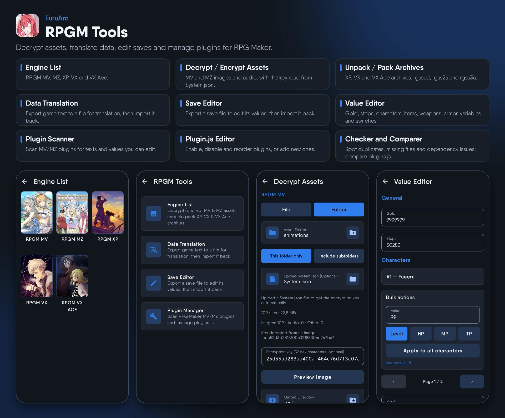
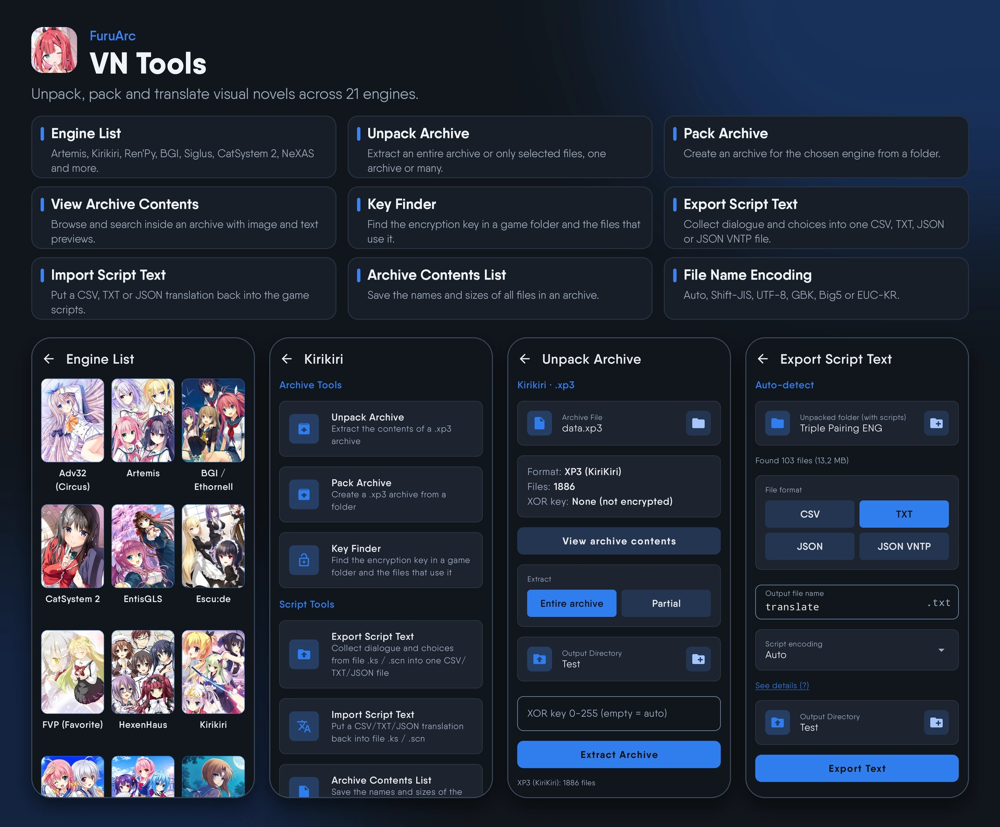
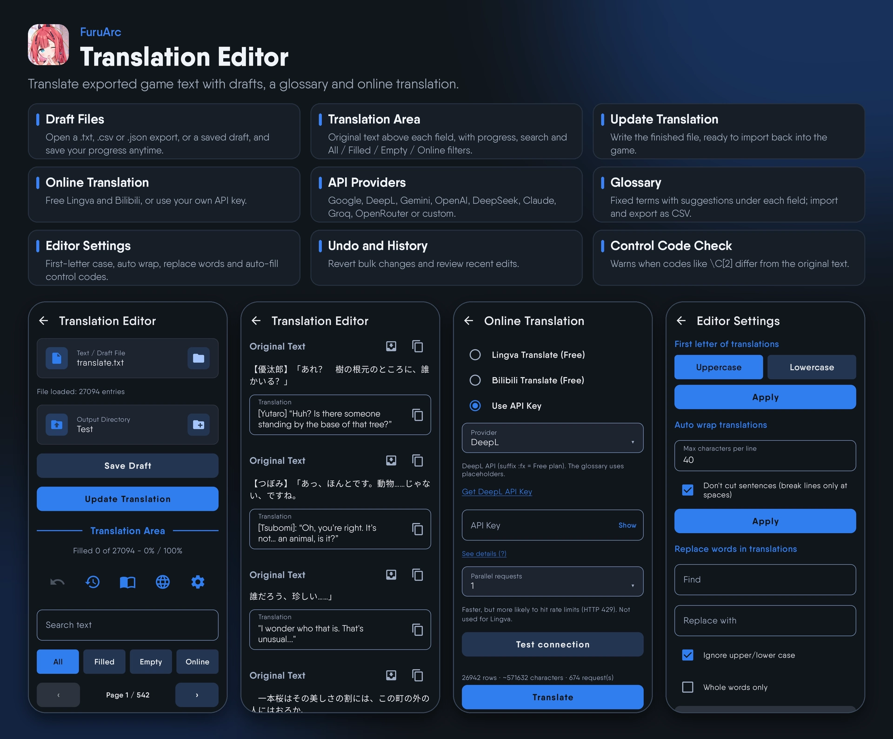
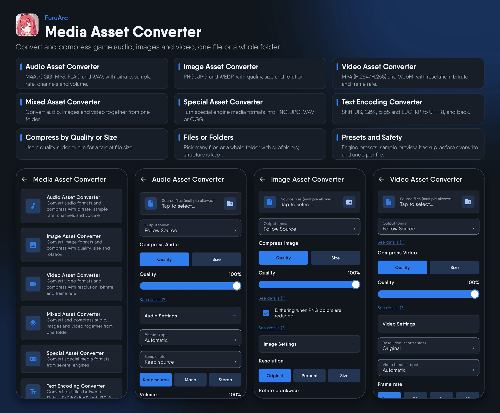
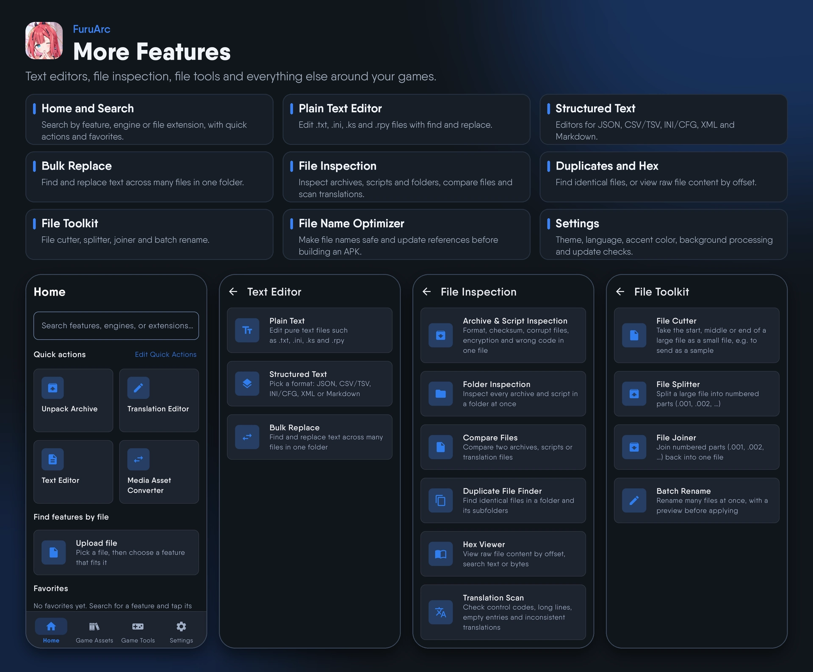

<p align="center">
  
</p>

<p align="center">
  <a href="LICENSE"></a>
  
  
  
  <a href="https://github.com/Fueeru26/FuruArc/releases"></a>
</p>

# FuruArc

**English** | [Bahasa Indonesia](README_ID.md)

**FuruArc** is an Android toolkit for **RPG Maker** and **Visual Novel** games. It runs entirely on your phone: unpack and pack game archives, decrypt assets, extract and translate script text, edit save files, convert audio, images and video, and browse the assets of your game library, with no PC required.

The app is written in Kotlin with Jetpack Compose. Every tool works through Android's Storage Access Framework, so it can open files and folders anywhere on the device (including game folders on external storage) without broad storage permissions. The interface is available in **Indonesian, English, Japanese, Chinese and Korean**, with light and dark themes.

> **Note**
> FuruArc is a general-purpose modding and localization utility. Use it only with games and files you own or are allowed to modify, and respect the licenses and terms of the games you work with.

## Contents

- [Features](#features)
  - [Home](#home)
  - [Game Assets (library)](#game-assets-library)
  - [RPGM Tools](#rpgm-tools)
  - [VN Tools](#vn-tools)
  - [Translation Editor](#translation-editor)
  - [Media Asset Converter](#media-asset-converter)
  - [Text Editors](#text-editors)
  - [File Inspection](#file-inspection)
  - [File Toolkit and File Name Optimizer](#file-toolkit-and-file-name-optimizer)
  - [Settings and updates](#settings-and-updates)
- [Supported engines](#supported-engines)
- [Installation](#installation)
- [Building from source](#building-from-source)
- [Project structure](#project-structure)
- [Contributing](#contributing)
- [License](#license)
- [Credits](#credits)

## Features

### Home

The first tab is a launcher for everything in the app.

- **Feature search**: type a feature name, an engine, or a file extension (for example `xp3`, `tlg`, `translate`) and open the result directly. The menu path is shown under each result, and a star adds it to Favorites.
- **Search history** and **Recently used** chips.
- **Quick actions**: up to 10 shortcuts you choose and reorder yourself (drag handle to reorder, ✕ to remove). The defaults are Unpack Archive, Translation Editor, Text Editor and Media Asset Converter.
- **Find features by file**: pick any file and FuruArc suggests the features that fit its extension. When you choose one, the file is loaded into that feature automatically, so you do not have to pick it again.
- **Favorites** for the tools you use most.

### Game Assets (library)

<p align="center"></p>

Add your games as a library and browse what is inside them.

- **Game library** with covers, sorting (name, recently added, random), favorites, bulk-add of a parent folder (every sub-folder becomes a game) and cover search on the internet.
- **Audio**: browse and play game audio, including special formats (OVK, NWA, MIO and encrypted RPG Maker `.rpgmvo` / `.rpgmvm`).
- **Images**: preview game images, including special engine formats (`.crx`, `.pgd`, `.pna`, `.ycg`, `.hg2`, `.hg3`, `.tlg`, `.eri`, `.g00`, `.rct`, `.rc8`).
- **Video**: play game video.
- **Text**: read and search script and text files.
- **Archive scanning**: archives inside the game are scanned so their contents show up as assets.
- **Extract, share and favorite** any asset.

### RPGM Tools

<p align="center"></p>

Decrypt assets, translate data, edit saves and manage plugins for RPG Maker.

| Tool | What it does |
| --- | --- |
| Engine List | RPGM MV, MZ, XP, VX and VX Ace. |
| Decrypt / Encrypt Assets | MV and MZ images and audio; the key is read from `System.json` or detected from an image. File or folder mode, with sub-folders. |
| Unpack / Pack Archives | XP, VX and VX Ace archives: `rgssad`, `rgss2a` and `rgss3a`. |
| Data Translation | Export game text to a file for translation, then import it back. |
| Save Editor | Export a save file to edit its values, then import it back (`rpgsave` / `rmmzsave`). |
| Value Editor | Gold, steps, characters (level, HP, MP, TP), items, weapons, armor, variables and switches, with bulk actions. |
| Plugin Scanner | Scan MV/MZ plugins for texts and values you can edit. |
| Plugin.js Editor | Enable, disable and reorder plugins, or add new ones. |
| Checker and Comparer | Spot duplicates, missing files and dependency issues; compare `plugins.js` files. |

### VN Tools

<p align="center"></p>

Unpack, pack and translate visual novels across 21 engines (see [Supported engines](#supported-engines)).

| Tool | What it does |
| --- | --- |
| Engine List | Pick an engine, or let FuruArc detect the format automatically. |
| Unpack Archive | Extract an entire archive or only selected files, one archive or many at once. |
| Pack Archive | Create an archive for the chosen engine from a folder. |
| View Archive Contents | Browse and search inside an archive with image and text previews. |
| Key Finder | Find the encryption key in a game folder and the files that use it. |
| Export Script Text | Collect dialogue and choices into one CSV, TXT, JSON or JSON VNTP file. |
| Import Script Text | Put a CSV, TXT or JSON translation back into the game scripts. |
| Archive Contents List | Save the names and sizes of all files in an archive. |
| File Name Encoding | Auto, Shift-JIS, UTF-8, GBK, Big5 or EUC-KR. |

### Translation Editor

<p align="center"></p>

Translate exported game text with drafts, a glossary and online translation.

- **Draft files**: open a `.txt`, `.csv` or `.json` export, or a saved draft, and save your progress at any time.
- **Translation area**: the original text above each field, with progress, search and All / Filled / Empty / Online filters.
- **Update Translation**: write the finished file, ready to import back into the game.
- **Online translation**: free Lingva and Bilibili, or use your own API key with Google, DeepL, Gemini, OpenAI, DeepSeek, Claude, Groq, OpenRouter or a custom endpoint. Parallel requests, connection test and an estimate of requests before you start.
- **Glossary**: fixed terms with suggestions under each field; import and export as CSV.
- **Editor settings**: first-letter case, auto wrap, replace words and auto-fill control codes.
- **Undo and history**: revert bulk changes and review recent edits.
- **Control code check**: warns when codes such as `\C[2]` differ from the original text.

### Media Asset Converter

<p align="center"></p>

Convert and compress game audio, images and video, one file or a whole folder.

- **Audio**: M4A, OGG, MP3, FLAC and WAV, with bitrate, sample rate, channels and volume.
- **Image**: PNG, JPG and WEBP, with quality, size and rotation; optional dithering when PNG colors are reduced.
- **Video**: MP4 (H.264 / H.265) and WebM, with resolution, bitrate and frame rate.
- **Mixed**: convert audio, images and video together from one folder.
- **Special Asset Converter**: turn special engine media formats into PNG, JPG, WAV or OGG.
- **Text Encoding Converter**: Shift-JIS, GBK, Big5 and EUC-KR to UTF-8, and back.
- **Compress by quality or by target size**, with pick-many-files or whole-folder input (structure is kept).
- **Presets and safety**: engine presets, sample preview, backup before overwriting and undo per file.

### Text Editors

<p align="center"></p>

- **Plain Text Editor**: `.txt`, `.ini`, `.ks`, `.rpy` and similar, with find and replace (regex), go to line, syntax highlighting, undo/redo, automatic encoding detection and auto-saved drafts.
- **Structured Text**: JSON (tree and text views), CSV / TSV (cell table), INI / CFG, XML and Markdown (with preview).
- **Bulk Replace**: find and replace text across many files in one folder, with a match counter before anything is changed.

### Media Player

Support Tools > Media Player has Image Gallery, Audio Player and Video Player.

- Audio and Video: **Player**, **Queue**, **Folders** and **Playlists** tabs. Folders list only their names; tapping one scans it into the Queue (with an optional "include subfolders" switch). The Queue shows covers and tags, reorders with up/down arrows, pages by 50 and has a three-dot menu (info, play next, remove, favorites, playlists, share, File Inspection). Playlists are cards in 3 columns with a built-in Favorites list.
- Player: repeat, shuffle, speed, A-B loop, sleep timer, equalizer, background play with notification controls, remembered position. Video adds rotate, fullscreen, double-tap skip and swipe brightness / volume.
- Image Gallery: Gallery, Folders and Collections; list or grid view, 60 per page, pinch zoom and slideshow.
- Media Settings: many player options plus export / import of settings and all lists.
- Game Assets viewers have a Media Player icon to open an asset here.
- **Open with...**: files from file managers or Share / Send to open in FuruArc (media in Media Player, known text/archive formats in the matching feature, unknown formats in File Inspection). Can be disabled in System settings.

### File Inspection

- **Archive and Script Inspection**: format, checksum, corrupt files, encryption and wrong-code detection in one file.
- **Folder Inspection**: inspect every archive and script in a folder at once.
- **Compare Files**: compare two archives, scripts or translation files.
- **Duplicate File Finder**: identical files in a folder and its sub-folders.
- **Hex Viewer**: raw file content by offset, with text and byte search.
- **Translation Scan**: control codes, long lines, empty entries and inconsistent translations.
- **Key Finder**: find the encryption key and the files that use it.

### File Toolkit and File Name Optimizer

- **File Cutter**: take the start, middle or end of a large file as a small file, for example to send a sample.
- **File Splitter / Joiner**: split a large file into numbered parts (`.001`, `.002`, ...) and join them back.
- **Batch Rename**: rename many files at once, with a preview before applying.
- **File Name Optimizer**: make file names safe (non-Latin characters) and update references before building an APK.

### Settings and updates

- Theme (light / dark), language, accent color.
- **Theme Schedule**, a **Seasonal** automatic style, and switches for animations and haptic feedback.
- **Display Style** (Classic, Minimal, Soft, Gradient, Solid, and the themed Sakura, Ocean, Forest, Sunset, Neon, Paper) and **Navigation Bar Style** (Classic, Floating, Floating Icons, Icons Only, Sliding Pill, Top Line, Floating Button), both at the top of Display settings.
- Press animations, soft screen transitions, shrinking headers and illustrated empty states.
- **Run in background**: long jobs keep running when the app is closed, with a notification when they finish (Android 13+ asks for the notification permission when you enable it).
- **Check for updates**: looks up the latest GitHub release (pre-releases included). A red dot marks Settings when a new version exists, a pop-up appears once per version and, if background notifications are enabled, a system notification is posted. "Download latest version" downloads the APK inside the app, with a progress window and notification, then "Install app" opens the system installer. Nothing is downloaded until you tap the button, and installing always needs your confirmation.
- In-app guide, Q&A and troubleshooting pages.

## Supported engines

**Visual novels (21)**

Artemis (`.pfs`), Kirikiri (`.xp3`), Ren'Py (`.rpa`), BGI / Ethornell (`.arc`), Softpal ADV System (`.pac`), WillPlus / AdvHD (`.arc`), NScripter (`.sar`), Tyrano Script (`.nw`), FVP / Favorite (`.bin`), Adv32 / Circus (`.pck`, `.dat`, `.crm`), Silky Engine (`.arc`), CatSystem 2 (`.int`), Siglus Engine (`.pck`, `Gameexe.dat`, voice `.ovk`), QLIE (`.pack`), Yu-Ris (`.ypf`), Escu:de (`.bin`), Yaneurao Itufuru (`.scd`), EntisGLS (`.noa`), NeXAS (`.pac`), Majiro (`.arc`) and HexenHaus (`.arc`, ODIO, WAG).

Script text tools (export / import) are available for a subset of these engines; the in-app engine list shows what each engine supports.

**RPG Maker**

MV and MZ (per-file asset encryption), XP (`.rgssad`), VX (`.rgss2a`) and VX Ace (`.rgss3a`).

## Installation

Download the latest APK from the [Releases](https://github.com/Fueeru26/FuruArc/releases) page and install it. Requires **Android 7.0 (API 24)** or newer.

## Building from source

Requirements: JDK 11 and the Android SDK (platform 33). The Gradle wrapper is included.

```bash
git clone https://github.com/Fueeru26/FuruArc.git
cd FuruArc
./gradlew assembleDebug
```

The debug APK is written to `app/build/outputs/apk/debug/`.

| Component | Version |
| --- | --- |
| Android Gradle Plugin | 4.2.2 |
| Gradle | 7.5.1 |
| Kotlin | 1.6.10 |
| Jetpack Compose (UI, Material 2) | 1.1.1 |
| compileSdk / targetSdk / minSdk | 33 / 34 / 24 |

> **Signing**
> No keystore or password is stored in this repository. Debug builds need no signing. For a signed release, provide your own keystore through the environment variables `ANDROID_KEYSTORE_FILE`, `ANDROID_KEYSTORE_PASSWORD`, `ANDROID_KEY_ALIAS` and `ANDROID_KEY_PASSWORD`, or through an untracked `keystore.properties` in the project root (`storeFile`, `storePassword`, `keyAlias`, `keyPassword`). Without them `assembleRelease` produces an unsigned APK.

## Project structure

```text
FuruArc/
├── app/
│   ├── build.gradle.kts
│   ├── proguard-rules.pro
│   └── src/main/
│       ├── AndroidManifest.xml
│       ├── res/                          Icons, engine covers, backup rules
│       └── java/
│           ├── com/furuarc/
│           │   ├── MainActivity.kt       Navigation and app shell
│           │   ├── *Jobs.kt              Long-running jobs (RPGM, scripts, media, plugins, inspection)
│           │   ├── core/                 Archive interfaces, format registry, readers/writers, update checker
│           │   ├── formats/              One file per engine archive format
│           │   ├── storage/              Storage Access Framework helpers
│           │   ├── settings/             App settings
│           │   ├── i18n/                 UI strings (ID/EN) and JA/ZH/KO translation data
│           │   └── ui/                   Compose screens, components and theme
│           ├── net/sourceforge/lame/     java-lame (LGPL), MP3 encoder
│           └── org/xiph/                 vorbis-java (BSD-style), OGG/Vorbis encoder
├── languages/                            App text in 5 languages as JSON (Indonesian, English, Japanese, Chinese, Korean)
├── pictures/                             README images
├── README_ID.md                          README in Indonesian
├── CHANGELOG.md                          Release notes
├── THIRD_PARTY_NOTICES.md
├── CONTRIBUTING.md
├── SECURITY.md
└── LICENSE
```

## Contributing

Bug reports, engine format notes and pull requests are welcome. Please read [CONTRIBUTING.md](CONTRIBUTING.md) first. For security issues see [SECURITY.md](SECURITY.md).

## License

FuruArc is licensed under the **GNU General Public License v3.0**. See [LICENSE](LICENSE). Bundled third-party code keeps its own license, see [THIRD_PARTY_NOTICES.md](THIRD_PARTY_NOTICES.md).

## Credits

- Created by **Fueeru** ([@Fueeru26](https://github.com/Fueeru26)).
- [java-lame](https://github.com/nwaldispuehl/java-lame) (LGPL): MP3 encoding.
- [vorbis-java](https://github.com/tulskiy/musique) and the Xiph.Org Foundation: OGG/Vorbis encoding.
- Format behavior was checked against the open-source tools [GARbro](https://github.com/morkt/GARbro) and [msg-tool](https://github.com/lifegpc/msg-tool).
