<p align="center">
  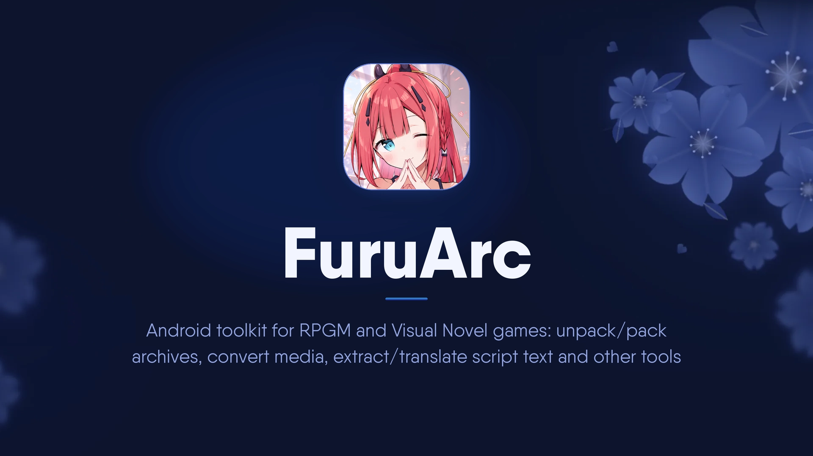
</p>

<p align="center">
  <a href="LICENSE"></a>
  
  
  
  <a href="https://github.com/Fueeru26/FuruArc/releases"></a>
  <a href="https://github.com/Fueeru26/FuruArc/actions/workflows/build.yml"></a>
  <a href="https://github.com/Fueeru26/FuruArc/releases"></a>
</p>

# FuruArc

**English** | [Bahasa Indonesia](README_ID.md)

**FuruArc** is an Android toolkit for **RPG Maker** and **Visual Novel** games. It runs entirely on your phone: unpack and pack game archives, decrypt assets, extract and translate script text, edit save files, convert audio, images and video, and browse the assets of your game library, with no PC required.

The app is written in Kotlin with Jetpack Compose. Every tool works through Android's Storage Access Framework, so it can open files and folders anywhere on the device (including game folders on external storage) without broad storage permissions. The interface is available in **Indonesian, English, Japanese, Chinese and Korean**, with light and dark themes.

> **Note**
> FuruArc is a general-purpose modding and localization utility. Use it only with games and files you own or are allowed to modify, and respect the licenses and terms of the games you work with.

## Contents

- [Features](#features)
  - [Home](#home)
  - [Game Assets (library)](#game-assets-library)
  - [RPGM Tools](#rpgm-tools)
  - [VN Tools](#vn-tools)
  - [Translation Editor](#translation-editor)
  - [Media Asset Converter](#media-asset-converter)
  - [Text Editors](#text-editors)
  - [Image Editor](#image-editor)
  - [Media Player](#media-player)
  - [File & Folder Inspector](#file--folder-inspector)
  - [File Toolkit and File Name Optimizer](#file-toolkit-and-file-name-optimizer)
  - [Settings and updates](#settings-and-updates)
- [Supported engines](#supported-engines)
- [Known limitations](#known-limitations)
- [Installation](#installation)
- [Building from source](#building-from-source)
- [Project structure](#project-structure)
- [Documentation](#documentation)
- [Contributing](#contributing)
- [License](#license)
- [Credits](#credits)

## Features

### Home

<p align="center">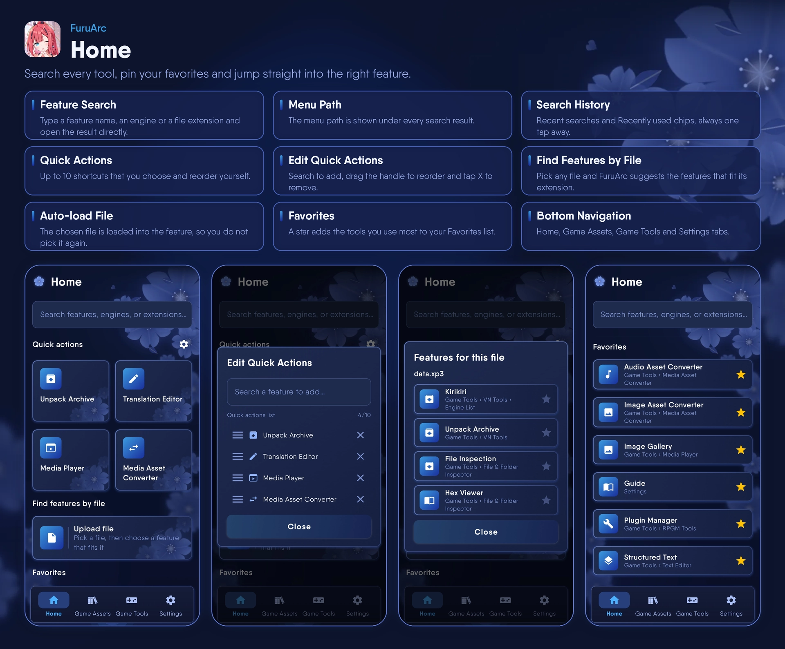</p>

The first tab is a launcher for everything in the app.

- **Feature search**: type a feature name, an engine, or a file extension (for example `xp3`, `tlg`, `translate`) and open the result directly. The menu path is shown under each result, and a star adds it to Favorites.
- **Search history** and **Recently used** chips.
- **Quick actions**: up to 10 shortcuts you choose and reorder yourself (drag handle to reorder, ✕ to remove). The defaults are Unpack Archive, Translation Editor, Media Player and Media Asset Converter.
- **Find features by file**: pick any file and FuruArc suggests the features that fit its extension. When you choose one, the file is loaded into that feature automatically, so you do not have to pick it again.
- **Favorites** for the tools you use most.

### Game Assets (library)

<p align="center">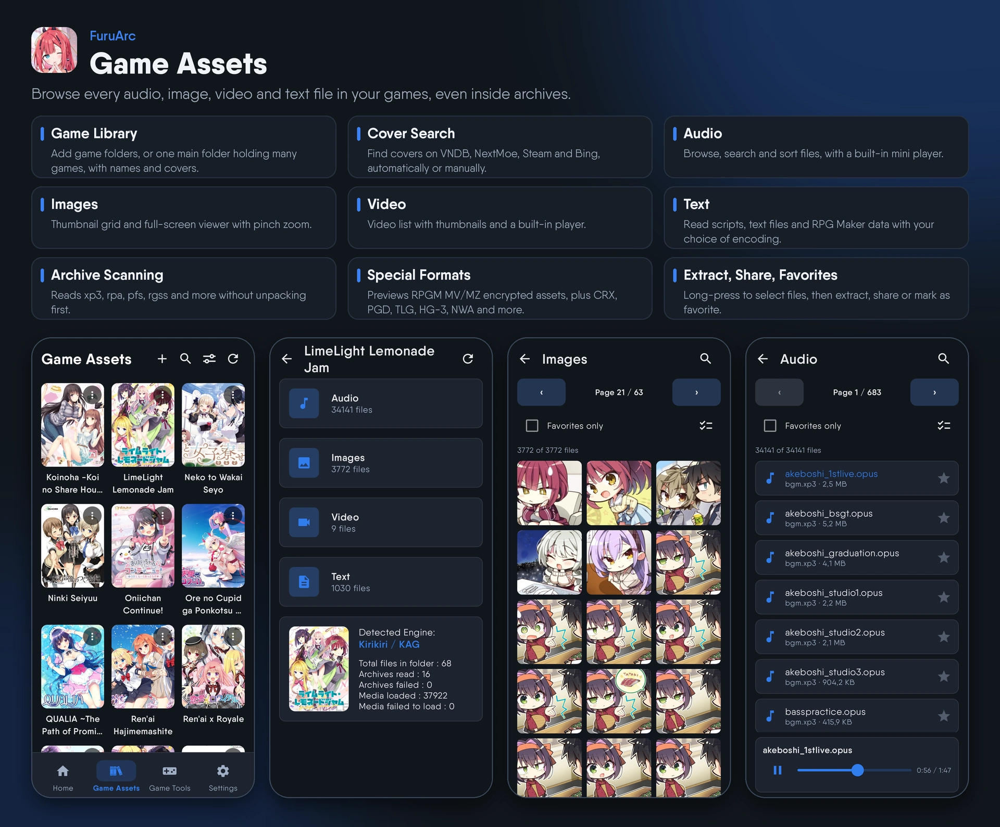</p>

Add your games as a library and browse what is inside them.

- **Game library** with covers, sorting (name, recently added, random), favorites, bulk-add of a parent folder (every sub-folder becomes a game) and cover search on the internet.
- Each list (Audio, Images, Video, Text) has a sort icon left of the search icon: file name A-Z / Z-A, largest / smallest first, random.
- **Audio**: browse and play game audio, including special formats (OVK, NWA, MIO and encrypted RPG Maker `.rpgmvo` / `.rpgmvm`).
- **Images**: preview game images, including special engine formats (`.crx`, `.pgd`, `.pna`, `.ycg`, `.hg2`, `.hg3`, `.tlg`, `.eri`, `.g00`, `.rct`, `.rc8`).
- **Video**: play game video.
- **Text**: read and search script and text files.
- **Archive scanning**: archives inside the game are scanned so their contents show up as assets.
- **Extract, share and favorite** any asset.

### RPGM Tools

<p align="center">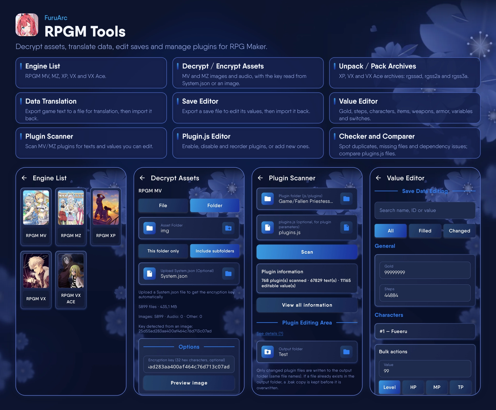</p>

Decrypt assets, translate data, edit saves and manage plugins for RPG Maker.

| Tool | What it does |
| --- | --- |
| Engine List | RPGM MV, MZ, XP, VX and VX Ace. |
| Decrypt / Encrypt Assets | MV and MZ images and audio; the key is read from `System.json` or detected from an image. File or folder mode, with sub-folders. |
| Unpack / Pack Archives | XP, VX and VX Ace archives: `rgssad`, `rgss2a` and `rgss3a`. |
| Data Translation | Export game text to a file for translation, then import it back. |
| Save Editor | Export a save file to edit its values, then import it back (`rpgsave` / `rmmzsave`). |
| Value Editor | Gold, steps, characters (level, HP, MP, TP), items, weapons, armor, variables and switches, with bulk actions. |
| Plugin Scanner | Scan MV/MZ plugins for texts and values you can edit. |
| Plugin.js Editor | Enable, disable and reorder plugins, or add new ones. |
| Checker and Comparer | Spot duplicates, missing files and dependency issues; compare `plugins.js` files. |

### VN Tools

<p align="center"></p>

Unpack, pack and translate visual novels across 24 engines (see [Supported engines](#supported-engines)).

| Tool | What it does |
| --- | --- |
| Engine List | Pick an engine, or let FuruArc detect the format automatically. |
| Unpack Archive | Extract an entire archive or only selected files, one archive or many at once. |
| Pack Archive | Create an archive for the chosen engine from a folder. |
| View Archive Contents | Browse and search inside an archive with image and text previews. |
| Key Finder | Find the encryption key in a game folder and the files that use it. |
| Export Script Text | Collect dialogue and choices into one CSV, TXT, JSON or JSON VNTP file. |
| Import Script Text | Put a CSV, TXT or JSON translation back into the game scripts. |
| Archive Contents List | Save the names and sizes of all files in an archive. |
| File Name Encoding | Auto, Shift-JIS, UTF-8, GBK, Big5 or EUC-KR. |

### Translation Editor

<p align="center">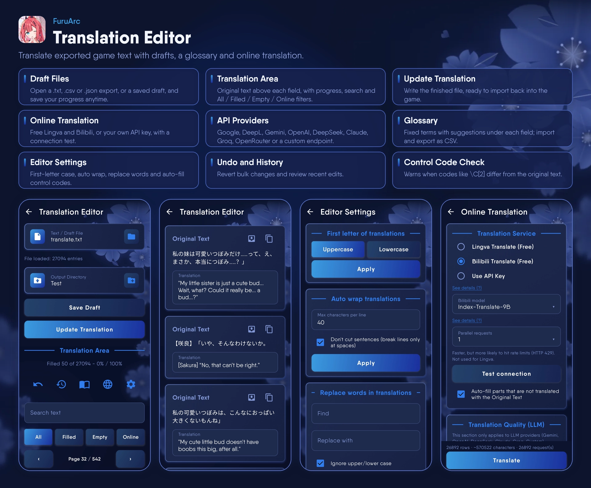</p>

Translate exported game text with drafts, a glossary and online translation.

- **Draft files**: open a `.txt`, `.csv` or `.json` export, or a saved draft, and save your progress at any time.
- **Translation area**: the original text above each field, every row on its own label background, with progress, search and All / Filled / Empty / Online filters.
- **Update Translation**: write the finished file, ready to import back into the game.
- **Online translation**: free Lingva and Bilibili, or use your own API key with Google, DeepL, Gemini, OpenAI, DeepSeek, Claude, Groq, OpenRouter or a custom endpoint. Parallel requests, connection test and an estimate of requests before you start.
- **Glossary**: fixed terms with suggestions under each field; import and export as CSV.
- **Editor settings**: first-letter case, auto wrap, replace words and auto-fill control codes.
- **Undo and history**: revert bulk changes and review recent edits.
- **Control code check**: warns when codes such as `\C[2]` differ from the original text.

### Media Asset Converter

<p align="center">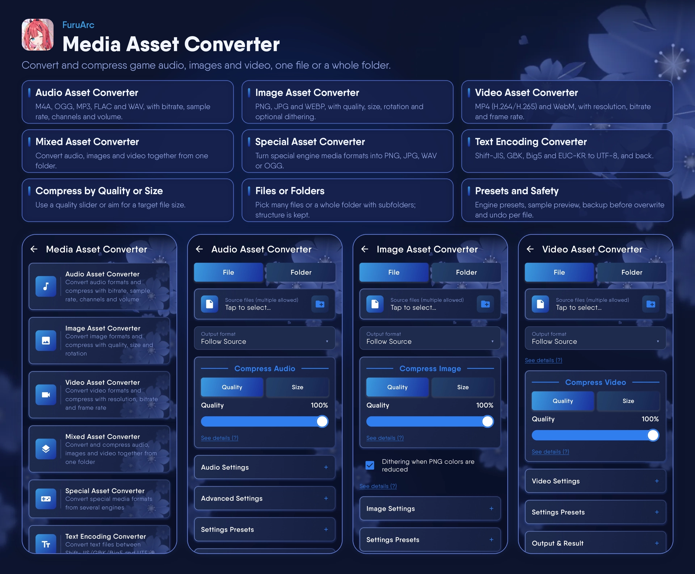</p>

Convert and compress game audio, images and video, one file or a whole folder.

- **Audio**: M4A, OGG, MP3, FLAC and WAV, with bitrate, sample rate, channels and volume.
- **Image**: PNG, JPG and WEBP, with quality, size and rotation; optional dithering when PNG colors are reduced.
- **Video**: MP4 (H.264 / H.265) and WebM, with resolution, bitrate and frame rate.
- **Mixed**: convert audio, images and video together from one folder.
- **Special Asset Converter**: turn special engine media formats into PNG, JPG, WAV or OGG.
- **Text Encoding Converter**: Shift-JIS, GBK, Big5 and EUC-KR to UTF-8, and back.
- **Compress by quality or by target size**, with pick-many-files or whole-folder input (structure is kept).
- **Presets and safety**: engine presets, sample preview, backup before overwriting and undo per file.

### Text Editors

<p align="center">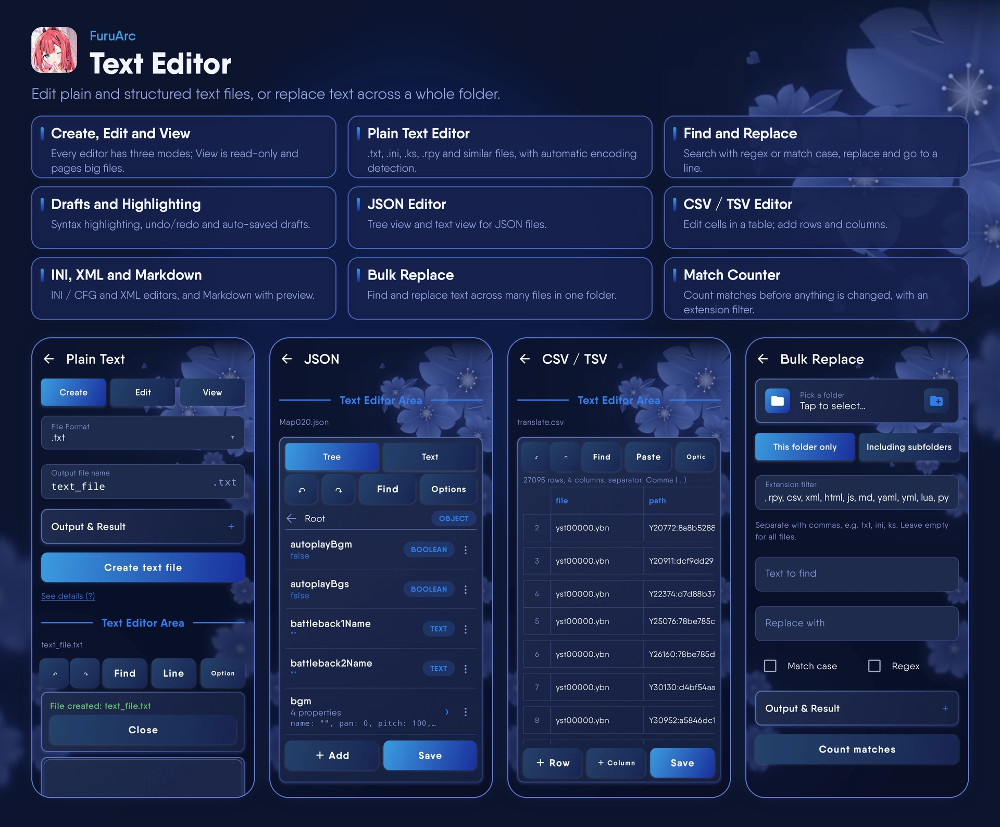</p>

- **Create / Edit / View**: every text editor has these three modes. View opens a file read-only (page by page when it is big) with an **Encoding** choice and a **Find** button above it (match case or regex, the match is highlighted) and **Edit** and **Copy** buttons under it; Edit moves the file to the Edit mode.
- **Plain Text Editor**: `.txt`, `.ini`, `.ks`, `.rpy` and similar, with find and replace (regex), go to line, syntax highlighting, undo/redo, automatic encoding detection and auto-saved drafts.
- **Structured Text**: JSON (tree and text views), CSV / TSV (cell table), INI / CFG, XML and Markdown (with preview).
- **Bulk Replace**: find and replace text across many files in one folder, with a match counter before anything is changed.

### Image Editor

Support Tools > Image Editor (between the Text Editor and the Media Player) edits one picture at a time, for example to translate text inside game images.

- **Move** (drag, pinch to zoom, Fit to screen), **Select** (crop, fill with a color, erase to transparent), **Brush** (with eraser), **Text** (centered on the tapped point, multi-line, outline, bold, Sans / Serif / Mono or a font file) and **Picker** (take a color from the image).
- **Clone**, **Fill from the surrounding colors** and **Blur / Pixelate** to cover old text; open an image **folder** with Previous / Next and **Save and next**; saved text styles.
- Rotate, flip and resize (aspect-ratio lock). Undo and redo for the last 6 steps. Images larger than 3072 px on the longest side are reduced when opened.
- Save as a new PNG, JPG or WebP file, or overwrite the original after a confirmation.

### Create Project

Game Tools > Create Project (below the RPGM Tools and VN Tools cards) holds step-by-step workflows built from the existing tools. Pick a source archive and a work folder once and the tools open with them filled in. Each step opens the matching tool, Back returns to the project, the next step has a "Continue" button, and Unpack, Export, Import, Pack and converter steps are marked Done automatically when they ran without failures. Add a note, rename, duplicate or delete a project (game files are never deleted); a project report can be copied or saved as a text file.

- **Game mechanism** (selector before the steps, also in the create dialog): RPGM MV / MZ, RPGM XP / VX / VX Ace or Visual Novel / general. The steps follow it. RPGM MV / MZ has no archive: the source is the untouched **Game folder**, the work folder is the **Result folder**, and the steps are Export / Import text straight from the JSON data, Decrypt assets, Re-encrypt assets (same `System.json` key, asked once in the tool), Check / edit plugins and Compare Folders (System.json ignored; copy the changed files into the patch folder) instead of Unpack and Pack. XP / VX / VX Ace and Visual Novel use the archive steps below.
- **Translation Project**: Unpack archive, Export text, Translate, Import text, Pack archive and Format test.
- **Compress Game Project**: Unpack archive, Scan assets, Compress audio, Compress images, Compress video and Pack archive. Compressed assets may not be accepted by the engine; keep the original archive and test the result.
- **Extract Assets Project**: Unpack archive, Scan assets, View assets in the Media Player, Convert assets, Find duplicates and Batch rename.
- **Make Patch Project**: Unpack the original, Edit files, Compare with the original, Pack the changed files as the patch archive and Format test.
- **Audit / Check Game Project**: Unpack, Scan assets, Check translations, Find duplicates and Format test (read-only checks).
- **Clean Up Project**: Unpack, Back up the folder, Scan assets, Find duplicates, Tidy file names, Shrink assets and Pack. Work on a copy: the Duplicate Finder deletes files.
- **Localize Assets Project**: Unpack, View assets, Edit images in the Image Editor, Convert assets, Compare with the original and Pack. For translating text inside game images.

### Media Player

<p align="center">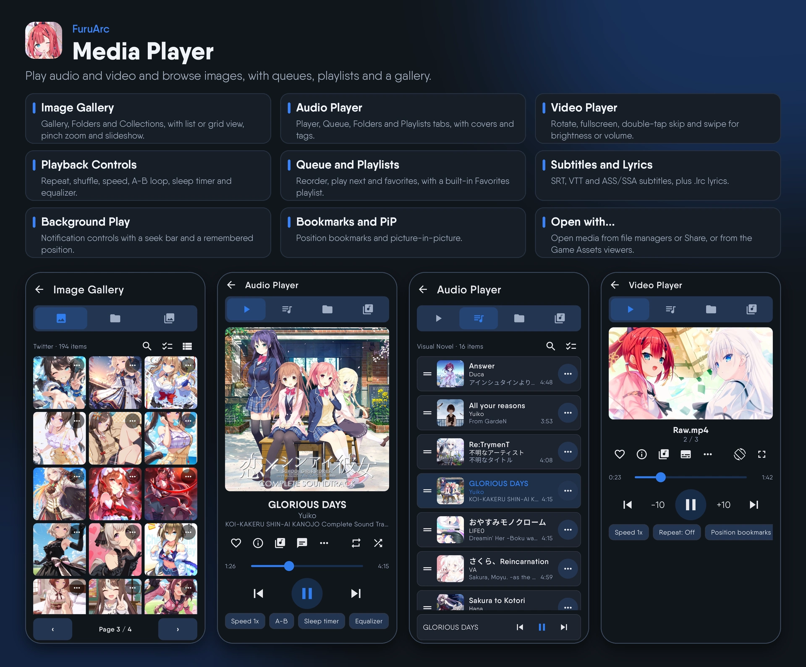</p>

Support Tools > Media Player has Image Gallery, Audio Player and Video Player.

- Audio and Video: **Player**, **Queue**, **Folders** and **Playlists** tabs. Folders list only their names; tapping one scans it into the Queue (with an optional "include subfolders" switch). The Queue shows covers and tags, reorders with up/down arrows, pages by 50 and has a three-dot menu (info, play next, remove, favorites, playlists, share, File Inspection). Playlists are cards in 3 columns with a built-in Favorites list.
- Player: repeat, shuffle, speed, A-B loop, sleep timer, equalizer, background play with notification controls, remembered position. Video adds rotate, fullscreen, double-tap skip and swipe brightness / volume.
- Image Gallery: Gallery, Folders and Collections; list or grid view, 60 per page, pinch zoom and slideshow.
- Media Settings: many player options plus export / import of settings, last played, Gallery, Queues, folders, collections and playlists.
- Apply to Queue / Gallery: Folders, Favorites, Collections and Playlists load directly into an empty list, otherwise choose Load (with a warning) or Add. Video Player subtitles (SRT, VTT, ASS/SSA). Media-style notification with seek bar. "Open with..." media is temporary and never overwrites your lists.
- Search and sort in Queue and Gallery (sort icon left of the search icon: title, artist, file name, duration, date, size, random; the list itself is reordered), View content / Empty for lists, lyrics (.lrc), subtitle timing and auto-load, bookmarks, picture-in-picture, drag or arrow ordering, and restoring the last played audio / video.
- Game Assets viewers have a Media Player icon to open an asset here.
- **Open with...**: files from file managers or Share / Send to open in FuruArc (media in Media Player; `.txt` and registered structured formats in View mode of the Text Editor; other known archive formats in the matching feature; unknown formats that are text in View mode of Plain Text; other unknown formats in File Inspection). Can be disabled in System settings.

### File & Folder Inspector

<p align="center">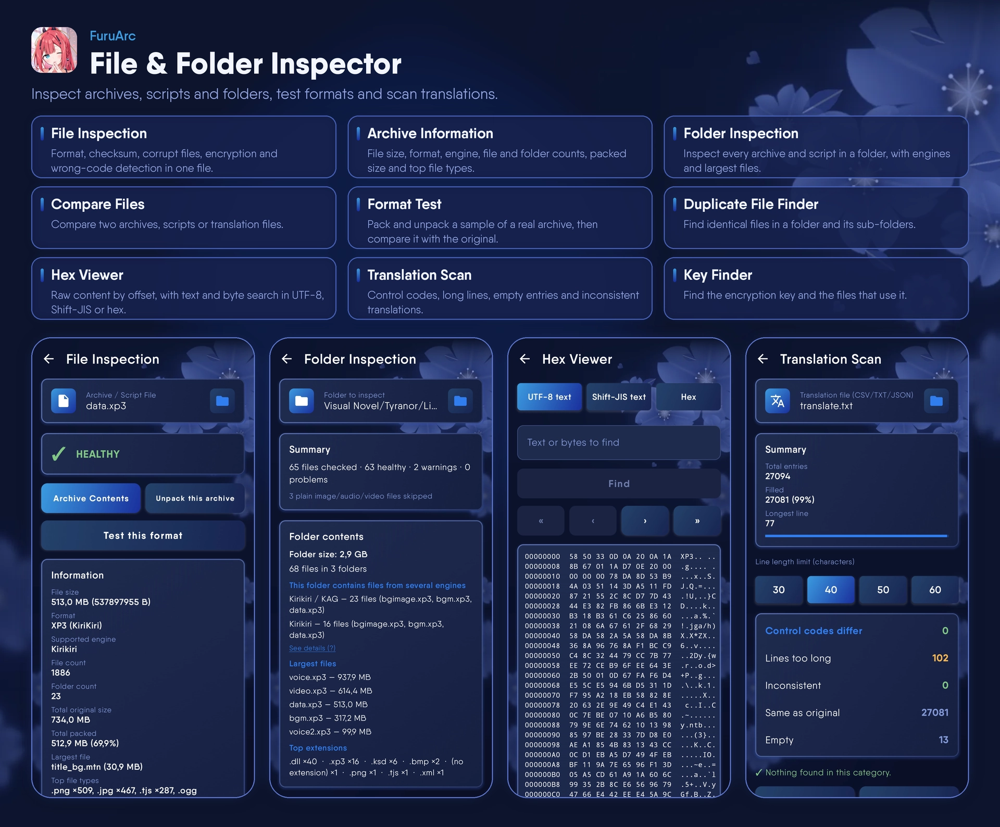</p>

- **File Inspection**: format, checksum, corrupt files, encryption and wrong-code detection in one file.
- **Folder Inspection**: inspect every archive and script in a folder at once.
- **Compare Files**: compare two archives, scripts or translation files.
- **Hex Viewer**: raw file content by offset, with text and byte search.
- **Format Test**: choose an engine (format) and upload a real archive of it. The app extracts one random file (up to a size limit you set in KB or MB), packs it into a new archive, unpacks that and compares it with your original (content by SHA-256, header, detection, size). You can test one random file (or a file you name), several, all, or all with a byte-for-byte comparison against the original; the seed repeats a test. No output folder; the result is listed, can be copied or exported, and the samples can be saved. File Inspection has a Test this format button. Engines that cannot be packed yet are not listed. The same format checks with generated samples also run in GitHub Actions.
- **Duplicate File Finder**: identical files in a folder and its sub-folders.
- **Compare Folders**: original vs edited folder (changed, new and missing files; an Ignore field leaves out names such as `System.json`); the changed and new files can be copied to another folder, for example to build a patch.
- **Translation Scan**: control codes, long lines, empty entries and inconsistent translations.
- **Key Finder**: find the encryption key and the files that use it.

### File Toolkit and File Name Optimizer

<p align="center">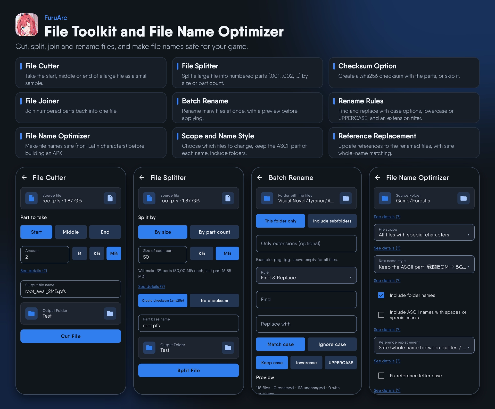</p>

- **File Cutter**: take the start, middle or end of a large file as a small file, for example to send a sample.
- **File Splitter / Joiner**: split a large file into numbered parts (`.001`, `.002`, ...) and join them back.
- **Batch Rename**: rename many files at once, with a preview before applying.
- **File Name Optimizer**: make file names safe (non-Latin characters) and update references before building an APK.

### Settings and updates

<p align="center">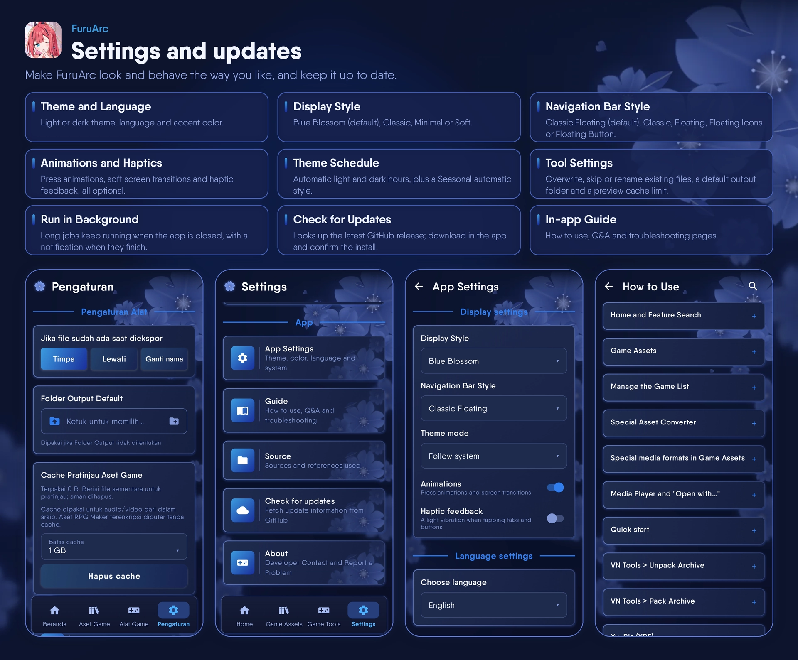</p>

- Theme (light / dark), language, accent color. Buttons and icon badges use a gradient derived from the accent color. In light mode the background is tinted by the theme color and cards stay near-white with a soft shadow; in dark mode cards are lighter than the background.
- Screen animations: sideways slide between tabs, pages rise from the bottom when opened and sink when closed (switch off in Display settings).
- **Theme Schedule**, a **Seasonal** automatic style, and switches for animations and haptic feedback.
- **Display Style** (Blue Blossom (default), Classic, Minimal, Soft) and **Navigation Bar Style** (Classic Floating (default), Classic, Floating, Floating Icons, Floating Button), both at the top of Display settings. The Theme Color picker is hidden while Blue Blossom is selected, because that style has its own colours (like the hour pickers that only show for Theme Schedule).
- Press animations, soft screen transitions, shrinking headers and illustrated empty states.
- **Run in background**: long jobs keep running when the app is closed, with a notification when they finish (Android 13+ asks for the notification permission when you enable it).
- **Check for updates**: looks up the latest GitHub release (pre-releases included). A red dot marks Settings when a new version exists, a pop-up appears once per version and, if background notifications are enabled, a system notification is posted. "Download latest version" downloads the APK inside the app, with a progress window and notification, then "Install app" opens the system installer. Nothing is downloaded until you tap the button, and installing always needs your confirmation.
- In-app guide, Q&A and troubleshooting pages.

## Supported engines

**Visual novels (24)**

Artemis (`.pfs`), Kirikiri (`.xp3`), Ren'Py (`.rpa`), BGI / Ethornell (`.arc`), Softpal ADV System (`.pac`), WillPlus / AdvHD (`.arc`), NScripter (`.sar`), Tyrano Script (`.nw`), FVP / Favorite (`.bin`), Adv32 / Circus (`.pck`, `.dat`, `.crm`), Silky Engine (`.arc`), CatSystem 2 (`.int`), Siglus Engine (`.pck`, `Gameexe.dat`, voice `.ovk`), QLIE (`.pack`), Yu-Ris (`.ypf`), Escu:de (`.bin`), Yaneurao Itufuru (`.scd`), EntisGLS (`.noa`), NeXAS (`.pac`), Majiro (`.arc`), AGE / Eushully (`.alf`), Shiina Rio (`.war`, WARC 1.1 only), Unity (UnityFS `.unity3d`, `.bundle`) and HexenHaus (`.arc`, ODIO, WAG).

Script text tools (export / import) are available for a subset of these engines; the in-app engine list shows what each engine supports.

**RPG Maker**

MV and MZ (per-file asset encryption), XP (`.rgssad`), VX (`.rgss2a`) and VX Ace (`.rgss3a`).

For what each engine supports (archive, pack, script text), see [docs/ENGINES.md](docs/ENGINES.md).

## Known limitations

- Script text export / import is available for a subset of the engines, not for all of them.
- Some formats are read-only: HexenHaus, and QLIE (plain entries only, no compressed or encrypted entries).
- NScripter: compressed NSA archives (SPB, LZSS, NBZ) are not supported.
- Shiina Rio: only WARC 1.1. Later versions use a per-title encryption scheme.
- Unity: only the UnityFS container (LZMA / LZ4). Encrypted bundles and objects inside serialized files are not processed.
- Tyrano Script: `app.asar` (Electron) and packages attached inside an `.exe` are not supported.
- Ren'Py: screens are not decompiled from `.rpyc` yet and are written as comments.
- Kirikiri: no per-game cipher, only an optional 1-byte XOR.

## Installation

Download the latest APK from the [Releases](https://github.com/Fueeru26/FuruArc/releases) page and install it. Requires **Android 7.0 (API 24)** or newer.

## Building from source

Requirements: JDK 11 and the Android SDK (platform 33). The Gradle wrapper is included.

```bash
git clone https://github.com/Fueeru26/FuruArc.git
cd FuruArc
./gradlew assembleDebug
```

The debug APK is written to `app/build/outputs/apk/debug/`.

| Component | Version |
| --- | --- |
| Android Gradle Plugin | 4.2.2 |
| Gradle | 7.5.1 |
| Kotlin | 1.6.10 |
| Jetpack Compose (UI, Material 2) | 1.1.1 |
| compileSdk / targetSdk / minSdk | 33 / 34 / 24 |

> **Signing**
> No keystore or password is stored in this repository. Debug builds need no signing. For a signed release, provide your own keystore through the environment variables `ANDROID_KEYSTORE_FILE`, `ANDROID_KEYSTORE_PASSWORD`, `ANDROID_KEY_ALIAS` and `ANDROID_KEY_PASSWORD`, or through an untracked `keystore.properties` in the project root (`storeFile`, `storePassword`, `keyAlias`, `keyPassword`). Without them `assembleRelease` produces an unsigned APK.

## Project structure

```text
FuruArc/
├── app/
│   ├── build.gradle.kts
│   ├── proguard-rules.pro
│   └── src/main/
│       ├── AndroidManifest.xml
│       ├── res/                          Icons, engine covers, backup rules
│       └── java/
│           ├── com/furuarc/
│           │   ├── MainActivity.kt       Navigation and app shell
│           │   ├── *Jobs.kt              Long-running jobs (RPGM, scripts, media, plugins, inspection)
│           │   ├── core/                 Archive interfaces, format registry, readers/writers, update checker
│           │   ├── formats/              One file per engine archive format
│           │   ├── storage/              Storage Access Framework helpers
│           │   ├── settings/             App settings
│           │   ├── i18n/                 UI strings (ID/EN) and JA/ZH/KO translation data
│           │   └── ui/                   Compose screens, components and theme
│           ├── net/sourceforge/lame/     java-lame (LGPL), MP3 encoder
│           └── org/xiph/                 vorbis-java (BSD-style), OGG/Vorbis encoder
├── docs/
│   ├── languages/                        App text in 5 languages as JSON (Indonesian, English, Japanese, Chinese, Korean)
│   ├── pictures/                         README images
│   ├── ENGINES.md                        What each engine supports (also ENGINES_ID.md)
│   ├── FAQ.md                            FAQ and troubleshooting (also FAQ_ID.md)
│   └── PRIVACY.md                        What the app stores and when it uses the network (also PRIVACY_ID.md)
├── .github/                              Issue and PR templates, workflows (build, release), Dependabot, funding
├── README_ID.md                          README in Indonesian
├── CHANGELOG.md                          Release notes
├── THIRD_PARTY_NOTICES.md
├── CONTRIBUTING.md
├── CODE_OF_CONDUCT.md
├── SECURITY.md
└── LICENSE
```

## Documentation

- [docs/ENGINES.md](docs/ENGINES.md): what FuruArc can do for each engine.
- [docs/FAQ.md](docs/FAQ.md): common questions and troubleshooting.
- [docs/PRIVACY.md](docs/PRIVACY.md): what is stored on your device and when the app connects to the internet.
- [CHANGELOG.md](CHANGELOG.md): release notes.

## Contributing

Bug reports, engine format notes and pull requests are welcome. Please read [CONTRIBUTING.md](CONTRIBUTING.md) first and follow the [Code of Conduct](CODE_OF_CONDUCT.md). For security issues see [SECURITY.md](SECURITY.md).

## License

FuruArc is licensed under the **GNU General Public License v3.0**. See [LICENSE](LICENSE). Bundled third-party code keeps its own license, see [THIRD_PARTY_NOTICES.md](THIRD_PARTY_NOTICES.md).

## Credits

- Created by **Fueeru** ([@Fueeru26](https://github.com/Fueeru26)).
- [java-lame](https://github.com/nwaldispuehl/java-lame) (LGPL): MP3 encoding.
- [vorbis-java](https://github.com/tulskiy/musique) and the Xiph.Org Foundation: OGG/Vorbis encoding.
- Format behavior was checked against the open-source tools [GARbro](https://github.com/morkt/GARbro) and [msg-tool](https://github.com/lifegpc/msg-tool).
