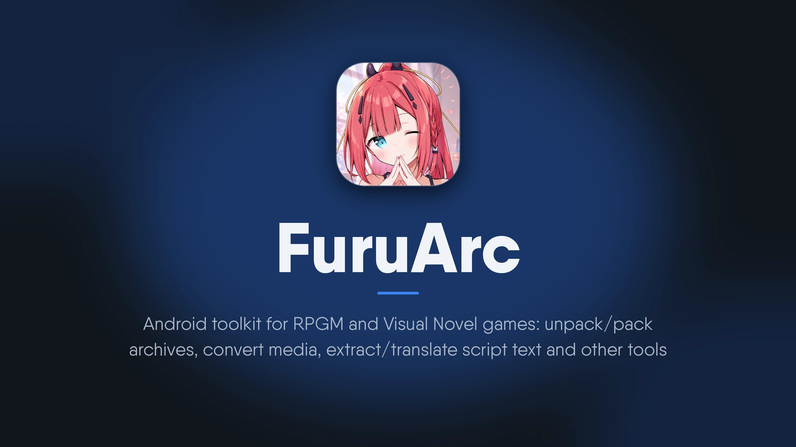
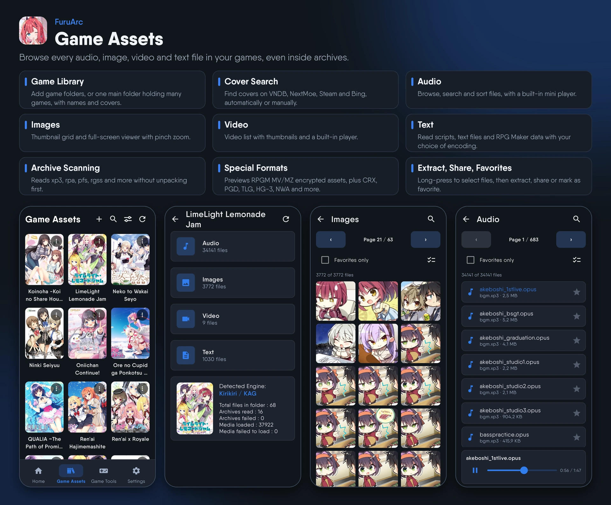
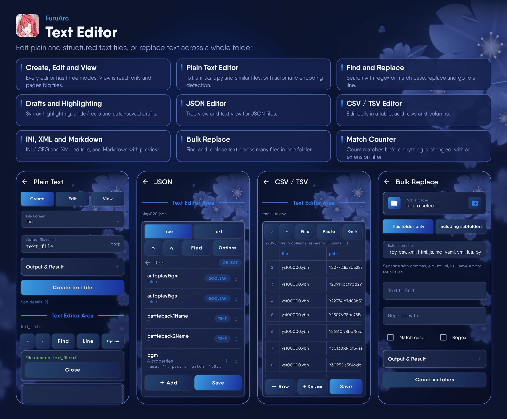
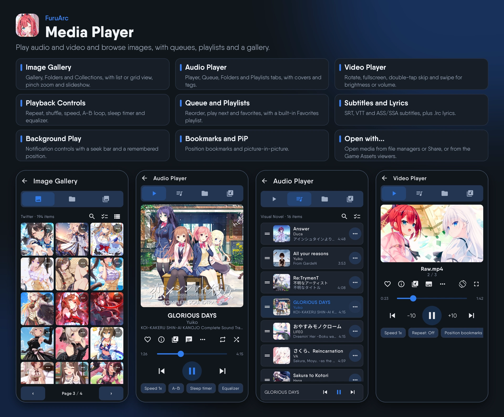
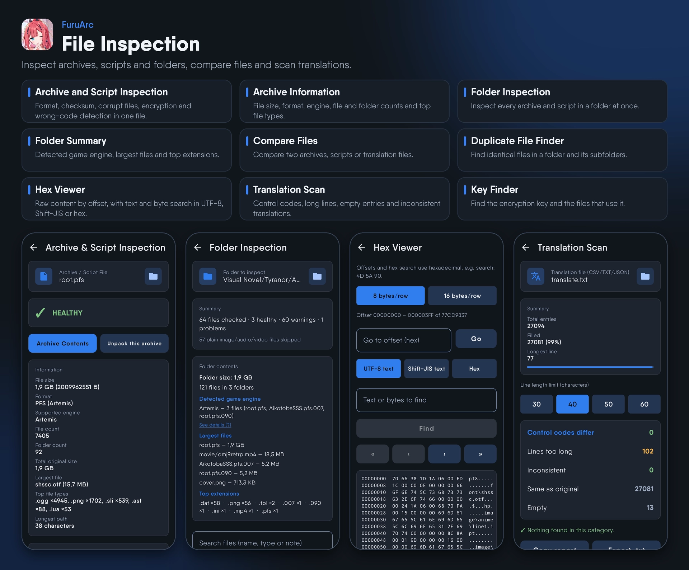

<p align="center">
  
</p>

<p align="center">
  <a href="LICENSE"></a>
  
  
  
  <a href="https://github.com/Fueeru26/FuruArc/releases"></a>
  <a href="https://github.com/Fueeru26/FuruArc/actions/workflows/build.yml"></a>
  <a href="https://github.com/Fueeru26/FuruArc/releases"></a>
</p>

# FuruArc

[English](README.md) | **Bahasa Indonesia**

**FuruArc** adalah toolkit Android untuk game **RPG Maker** dan **Visual Novel**. Semuanya berjalan langsung di HP: bongkar dan kemas arsip game, dekripsi aset, ekstrak dan terjemahkan teks skrip, edit file save, konversi audio, gambar dan video, serta telusuri aset pustaka game, tanpa perlu PC.

Aplikasi ditulis dengan Kotlin dan Jetpack Compose. Semua alat bekerja lewat Storage Access Framework Android, sehingga bisa membuka file dan folder di mana saja (termasuk folder game di penyimpanan eksternal) tanpa izin penyimpanan yang luas. Antarmuka tersedia dalam **Indonesia, Inggris, Jepang, Mandarin dan Korea**, dengan tema terang dan gelap.

> **Catatan**
> FuruArc adalah utilitas modding dan lokalisasi serbaguna. Gunakan hanya untuk game dan file milikmu sendiri atau yang boleh kamu ubah, dan hormati lisensi serta ketentuan game yang kamu kerjakan.

## Daftar isi

- [Fitur](#fitur)
  - [Beranda](#beranda)
  - [Aset Game (pustaka)](#aset-game-pustaka)
  - [Alat RPGM](#alat-rpgm)
  - [Alat VN](#alat-vn)
  - [Editor Terjemahan](#editor-terjemahan)
  - [Konverter Aset Media](#konverter-aset-media)
  - [Editor Teks](#editor-teks)
  - [Media Player](#media-player)
  - [Pemeriksa File dan Folder](#pemeriksa-file-dan-folder)
  - [Perkakas File dan Pengoptimal Nama File](#perkakas-file-dan-pengoptimal-nama-file)
  - [Pengaturan dan pembaruan](#pengaturan-dan-pembaruan)
- [Engine yang didukung](#engine-yang-didukung)
- [Keterbatasan yang diketahui](#keterbatasan-yang-diketahui)
- [Instalasi](#instalasi)
- [Build dari source](#build-dari-source)
- [Struktur proyek](#struktur-proyek)
- [Dokumentasi](#dokumentasi)
- [Berkontribusi](#berkontribusi)
- [Lisensi](#lisensi)
- [Kredit](#kredit)

## Fitur

### Beranda

<p align="center"></p>

Tab pertama adalah peluncur untuk semua fitur di aplikasi.

- **Cari fitur**: ketik nama fitur, engine, atau ekstensi file (misalnya `xp3`, `tlg`, `translate`) lalu buka hasilnya langsung. Jalur menu tampil di bawah tiap hasil, dan bintang menambahkannya ke Favorit.
- **Riwayat pencarian** dan chip **Terakhir dipakai**.
- **Aksi cepat**: hingga 10 pintasan yang kamu pilih dan urutkan sendiri (gagang seret untuk mengurutkan, ✕ untuk menghapus). Bawaannya Bongkar Arsip, Editor Terjemahan, Media Player dan Konverter Aset Media.
- **Cari fitur melalui file**: pilih file apa pun dan FuruArc menyarankan fitur yang cocok dengan ekstensinya. Saat kamu memilih salah satu, file langsung dimuat ke fitur tersebut, tanpa perlu memilih ulang.
- **Favorit** untuk alat yang paling sering dipakai.

### Aset Game (pustaka)

<p align="center"></p>

Tambahkan game sebagai pustaka dan telusuri isinya.

- **Pustaka game** dengan cover, pengurutan (nama, terakhir ditambahkan, acak), favorit, tambah folder induk sekaligus (tiap subfolder jadi satu game) dan pencarian cover di internet.
- **Audio**: telusuri dan putar audio game, termasuk format khusus (OVK, NWA, MIO dan `.rpgmvo` / `.rpgmvm` RPG Maker terenkripsi).
- **Gambar**: pratinjau gambar game, termasuk format khusus engine (`.crx`, `.pgd`, `.pna`, `.ycg`, `.hg2`, `.hg3`, `.tlg`, `.eri`, `.g00`, `.rct`, `.rc8`).
- **Video**: putar video game.
- **Teks**: baca dan cari file skrip dan teks.
- **Pemindaian arsip**: arsip di dalam game dipindai agar isinya tampil sebagai aset.
- **Ekstrak, bagikan dan favoritkan** aset apa pun.

### Alat RPGM

<p align="center"></p>

Dekripsi aset, terjemahkan data, edit save dan kelola plugin RPG Maker.

| Alat | Fungsi |
| --- | --- |
| Daftar Engine | RPGM MV, MZ, XP, VX dan VX Ace. |
| Dekripsi / Enkripsi Aset | Gambar dan audio MV dan MZ; kunci dibaca dari `System.json` atau dideteksi dari gambar. Mode file atau folder, termasuk subfolder. |
| Bongkar / Kemas Arsip | Arsip XP, VX dan VX Ace: `rgssad`, `rgss2a` dan `rgss3a`. |
| Terjemahan Data | Ekspor teks game untuk diterjemahkan, lalu impor kembali. |
| Editor Save | Ekspor file save untuk mengedit nilainya, lalu impor kembali (`rpgsave` / `rmmzsave`). |
| Editor Nilai | Gold, langkah, karakter (level, HP, MP, TP), item, senjata, armor, variabel dan switch, dengan aksi massal. |
| Pemindai Plugin | Pindai plugin MV/MZ untuk teks dan nilai yang bisa diedit. |
| Editor Plugin.js | Aktifkan, nonaktifkan dan urutkan plugin, atau tambah yang baru. |
| Pemeriksa dan Pembanding | Temukan duplikat, file hilang dan masalah dependensi; bandingkan file `plugins.js`. |

### Alat VN

<p align="center"></p>

Bongkar, kemas dan terjemahkan visual novel di 24 engine (lihat [Engine yang didukung](#engine-yang-didukung)).

| Alat | Fungsi |
| --- | --- |
| Daftar Engine | Pilih engine, atau biarkan FuruArc mendeteksi format otomatis. |
| Bongkar Arsip | Ekstrak seluruh arsip atau hanya file terpilih, satu atau banyak arsip sekaligus. |
| Kemas Arsip | Buat arsip untuk engine terpilih dari sebuah folder. |
| Lihat Isi Arsip | Telusuri dan cari isi arsip dengan pratinjau gambar dan teks. |
| Pencari Kunci | Cari kunci enkripsi di folder game dan file yang memakainya. |
| Ekspor Teks Skrip | Kumpulkan dialog dan pilihan ke satu file CSV, TXT, JSON atau JSON VNTP. |
| Impor Teks Skrip | Masukkan kembali terjemahan CSV, TXT atau JSON ke skrip game. |
| Daftar Isi Arsip | Simpan nama dan ukuran semua file di dalam arsip. |
| Encoding Nama File | Otomatis, Shift-JIS, UTF-8, GBK, Big5 atau EUC-KR. |

### Editor Terjemahan

<p align="center"></p>

Terjemahkan teks game hasil ekspor dengan draf, glosarium dan terjemahan online.

- **File draf**: buka ekspor `.txt`, `.csv` atau `.json`, atau draf tersimpan, dan simpan progres kapan saja.
- **Area terjemahan**: teks asli di atas tiap kolom, dengan progres, pencarian dan filter Semua / Terisi / Kosong / Online.
- **Perbarui Terjemahan**: tulis file jadi yang siap diimpor kembali ke game.
- **Terjemahan online**: Lingva dan Bilibili gratis, atau pakai API key sendiri dengan Google, DeepL, Gemini, OpenAI, DeepSeek, Claude, Groq, OpenRouter atau endpoint khusus. Permintaan paralel, uji koneksi dan perkiraan jumlah permintaan sebelum mulai.
- **Glosarium**: istilah tetap dengan saran di bawah tiap kolom; impor dan ekspor CSV.
- **Pengaturan editor**: huruf awal, bungkus otomatis, ganti kata dan isi otomatis kode kontrol.
- **Urungkan dan riwayat**: batalkan perubahan massal dan lihat suntingan terbaru.
- **Cek kode kontrol**: memperingatkan bila kode seperti `\C[2]` berbeda dari teks asli.

### Konverter Aset Media

<p align="center"></p>

Konversi dan kompres audio, gambar dan video game, satu file atau satu folder penuh.

- **Audio**: M4A, OGG, MP3, FLAC dan WAV, dengan bitrate, sample rate, kanal dan volume.
- **Gambar**: PNG, JPG dan WEBP, dengan kualitas, ukuran dan rotasi; dithering opsional saat warna PNG dikurangi.
- **Video**: MP4 (H.264 / H.265) dan WebM, dengan resolusi, bitrate dan frame rate.
- **Campuran**: konversi audio, gambar dan video sekaligus dari satu folder.
- **Konverter Aset Khusus**: ubah format media khusus engine menjadi PNG, JPG, WAV atau OGG.
- **Konverter Encoding Teks**: Shift-JIS, GBK, Big5 dan EUC-KR ke UTF-8, dan sebaliknya.
- **Kompres berdasarkan kualitas atau ukuran target**, dengan input beberapa file atau satu folder (struktur dipertahankan).
- **Preset dan keamanan**: preset engine, pratinjau sampel, cadangan sebelum menimpa dan urungkan per file.

### Editor Teks

<p align="center"></p>

- **Editor File Teks Biasa**: `.txt`, `.ini`, `.ks`, `.rpy` dan sejenisnya, dengan cari dan ganti (regex), lompat ke baris, pewarnaan sintaks, urungkan/ulangi, deteksi encoding otomatis dan draf tersimpan otomatis.
- **File Teks Berstruktur**: JSON (tampilan pohon dan teks), CSV / TSV (tabel sel), INI / CFG, XML dan Markdown (dengan pratinjau).
- **Ganti Massal**: cari dan ganti teks di banyak file dalam satu folder, dengan penghitung kecocokan sebelum apa pun diubah.

### Media Player

<p align="center"></p>

Alat Pendukung > Media Player berisi Galeri Gambar, Pemutar Audio, dan Pemutar Video.

- Audio dan Video: tab **Pemutar**, **Antrian**, **Folder**, dan **Daftar Putar**. Folder hanya menampilkan nama; mengetuk satu folder memindainya menjadi Antrian (dengan saklar "termasuk subfolder"). Antrian menampilkan cover dan tag, bisa diurutkan dengan panah atas/bawah, 50 item per halaman, dan punya menu titik tiga (info, putar berikutnya, hapus, favorit, daftar putar, kirim, Pemeriksaan File). Daftar Putar berupa kartu 3 kolom dengan daftar Favorit bawaan.
- Pemutar: ulangi, acak, kecepatan, ulang A-B, pewaktu tidur, equalizer, putar di latar belakang dengan kontrol notifikasi, posisi terakhir diingat. Video menambah putar layar, layar penuh, ketuk dua kali untuk loncat, dan geser untuk kecerahan / volume.
- Galeri Gambar: Galeri, Folder, dan Koleksi; tampilan daftar atau kotak, 60 per halaman, zoom cubit, dan slideshow.
- Pengaturan Media: banyak opsi pemutar serta ekspor / impor pengaturan dan semua daftar.
- Terapkan ke Antrian / Galeri: Folder, Favorit, Koleksi, dan Daftar Putar langsung dimuat ke daftar yang kosong, jika tidak pilih Muat (dengan peringatan) atau Tambahkan. Subtitle Pemutar Video (SRT, VTT, ASS/SSA). Notifikasi bergaya media dengan bilah geser. Media dari "Buka dengan..." bersifat sementara dan tidak menimpa daftar Anda.
- Pencarian di Antrian dan Galeri, Lihat isi / Kosongkan untuk daftar, lirik (.lrc), pengaturan waktu dan muat otomatis subtitle, bookmark, jendela mini (PiP), pengurutan drag atau panah, serta pemulihan audio / video terakhir.
- Penampil di Aset Game punya ikon Media Player untuk membuka aset di sini.
- **Buka dengan...**: file dari aplikasi file manager atau Bagikan / Kirim ke bisa dibuka di FuruArc (media di Media Player, teks/arsip di fitur yang cocok, format tidak dikenal di Pemeriksaan File). Bisa dimatikan di Pengaturan Sistem.

### Pemeriksa File dan Folder

<p align="center"></p>

- **Pemeriksaan File**: format, checksum, file rusak, enkripsi dan deteksi kode salah dalam satu file.
- **Pemeriksaan Folder**: periksa semua arsip dan skrip dalam satu folder sekaligus.
- **Bandingkan Pemeriksaan**: bandingkan dua arsip, skrip atau file terjemahan.
- **Penampil Hex**: isi mentah file berdasarkan offset, dengan pencarian teks dan byte.
- **Uji Coba Format**: mengemas file contoh buatan aplikasi dengan setiap format yang bisa dikemas lalu membongkarnya lagi di perangkatmu, kemudian membandingkan nama dan isinya. Tiap format tampil lulus, peringatan, gagal atau dilewati, dan hasilnya bisa disalin atau diekspor sebagai laporan untuk laporan bug. Ia juga mencoba contoh tepi (file kosong, tepat 1 MiB, nama Jepang, subfolder, 300 file), mengemas ulang hasil bongkar, menguji codec LZMA/LZ4/LZSS serta ekspor/impor teks skrip, dan memeriksa arsip asli kecil di `app/src/main/assets/formattest` lewat SHA-256. Tes yang sama berjalan di GitHub Actions.
- **Pencari File Duplikat**: file identik dalam folder dan subfoldernya.
- **Pemindaian Terjemahan**: kode kontrol, baris panjang, entri kosong dan terjemahan tidak konsisten.
- **Pencari Kunci**: cari kunci enkripsi dan file yang memakainya.

### Perkakas File dan Pengoptimal Nama File

<p align="center"></p>

- **Pemotong File**: ambil bagian awal, tengah atau akhir file besar menjadi file kecil, misalnya untuk mengirim sampel.
- **Pemisah / Penggabung File**: pecah file besar menjadi bagian bernomor (`.001`, `.002`, ...) dan gabungkan kembali.
- **Ganti Nama Massal**: ubah nama banyak file sekaligus, dengan pratinjau sebelum diterapkan.
- **Pengoptimal Nama File**: buat nama file aman (karakter non-Latin) dan perbarui referensinya sebelum membuat APK.

### Pengaturan dan pembaruan

- Tema (terang / gelap), bahasa, warna aksen.
- **Jadwal Tema**, gaya **Musiman** otomatis, serta saklar animasi dan getaran haptik.
- **Gaya Tampilan** (Klasik, Minimalis, Lembut, Gradien, Warna Pekat, dan bertema Sakura, Samudra, Hutan, Senja, Neon, Kertas) dan **Gaya Navigasi Bar** (Klasik, Melayang, Ikon Layang, Hanya Ikon, Pil Bergeser, Garis Atas, Tombol Mengambang), keduanya di bagian atas Pengaturan Tampilan.
- Animasi tekan, transisi layar yang halus, header yang menyusut saat di-scroll, dan ilustrasi untuk daftar kosong.
- **Proses latar belakang**: tugas panjang tetap berjalan saat aplikasi ditutup, dengan notifikasi saat selesai (Android 13+ meminta izin notifikasi saat kamu mengaktifkannya).
- **Periksa pembaruan**: mengecek rilis GitHub terbaru (termasuk pre-release). Titik merah menandai Pengaturan bila ada versi baru, pop-up muncul sekali per versi dan, bila notifikasi latar belakang aktif, notifikasi sistem ditampilkan. Tombol "Download versi terbaru" mengunduh APK di dalam aplikasi, dengan jendela progres dan notifikasi, lalu "Install aplikasi" membuka pemasang sistem. Tidak ada yang diunduh sebelum kamu menekan tombolnya, dan pemasangan selalu butuh konfirmasimu.
- Halaman panduan, tanya jawab dan pemecahan masalah di dalam aplikasi.

## Engine yang didukung

**Visual novel (24)**

Artemis (`.pfs`), Kirikiri (`.xp3`), Ren'Py (`.rpa`), BGI / Ethornell (`.arc`), Softpal ADV System (`.pac`), WillPlus / AdvHD (`.arc`), NScripter (`.sar`), Tyrano Script (`.nw`), FVP / Favorite (`.bin`), Adv32 / Circus (`.pck`, `.dat`, `.crm`), Silky Engine (`.arc`), CatSystem 2 (`.int`), Siglus Engine (`.pck`, `Gameexe.dat`, suara `.ovk`), QLIE (`.pack`), Yu-Ris (`.ypf`), Escu:de (`.bin`), Yaneurao Itufuru (`.scd`), EntisGLS (`.noa`), NeXAS (`.pac`), Majiro (`.arc`), AGE / Eushully (`.alf`), Shiina Rio (`.war`, hanya WARC 1.1), Unity (UnityFS `.unity3d`, `.bundle`) dan HexenHaus (`.arc`, ODIO, WAG).

Alat teks skrip (ekspor / impor) tersedia untuk sebagian engine di atas; daftar engine di aplikasi menunjukkan apa yang didukung tiap engine.

**RPG Maker**

MV dan MZ (enkripsi aset per file), XP (`.rgssad`), VX (`.rgss2a`) dan VX Ace (`.rgss3a`).

Untuk kemampuan tiap engine (arsip, kemas, teks skrip), lihat [docs/ENGINES_ID.md](docs/ENGINES_ID.md).

## Keterbatasan yang diketahui

- Ekspor / impor teks skrip tersedia untuk sebagian engine, tidak untuk semuanya.
- Beberapa format hanya bisa dibaca: HexenHaus, dan QLIE (hanya entri polos, tanpa entri terkompresi atau terenkripsi).
- NScripter: arsip NSA terkompresi (SPB, LZSS, NBZ) belum didukung.
- Shiina Rio: hanya WARC 1.1. Versi lebih baru memakai skema enkripsi per judul.
- Unity: hanya kontainer UnityFS (LZMA / LZ4). Bundle terenkripsi dan objek di dalam file serialized tidak diproses.
- Tyrano Script: `app.asar` (Electron) dan paket yang menempel di dalam `.exe` belum didukung.
- Ren'Py: layar (screen) dari `.rpyc` belum didekompilasi dan ditulis sebagai komentar.
- Kirikiri: belum ada cipher per game, hanya XOR 1 byte opsional.

## Instalasi

Unduh APK terbaru dari halaman [Releases](https://github.com/Fueeru26/FuruArc/releases) lalu pasang. Membutuhkan **Android 7.0 (API 24)** atau lebih baru. Setiap rilis mencantumkan checksum SHA-256 dari APK (dan melampirkan `SHA256SUMS.txt`) agar kamu bisa memverifikasi unduhannya.

## Build dari source

Kebutuhan: JDK 11 dan Android SDK (platform 33). Gradle wrapper sudah disertakan.

```bash
git clone https://github.com/Fueeru26/FuruArc.git
cd FuruArc
./gradlew assembleDebug
```

APK debug ada di `app/build/outputs/apk/debug/`.

| Komponen | Versi |
| --- | --- |
| Android Gradle Plugin | 4.2.2 |
| Gradle | 7.5.1 |
| Kotlin | 1.6.10 |
| Jetpack Compose (UI, Material 2) | 1.1.1 |
| compileSdk / targetSdk / minSdk | 33 / 34 / 24 |

> **Penandatanganan**
> Tidak ada keystore atau sandi di repositori ini. Build debug tidak membutuhkannya. Untuk rilis bertanda tangan, sediakan keystore milikmu lewat variabel lingkungan `ANDROID_KEYSTORE_FILE`, `ANDROID_KEYSTORE_PASSWORD`, `ANDROID_KEY_ALIAS` dan `ANDROID_KEY_PASSWORD`, atau lewat `keystore.properties` (tidak dilacak git) di root proyek (`storeFile`, `storePassword`, `keyAlias`, `keyPassword`). Tanpa itu, `assembleRelease` menghasilkan APK tanpa tanda tangan.

## Struktur proyek

```text
FuruArc/
├── app/
│   ├── build.gradle.kts
│   ├── proguard-rules.pro
│   └── src/main/
│       ├── AndroidManifest.xml
│       ├── res/                          Ikon, cover engine, aturan backup
│       └── java/
│           ├── com/furuarc/
│           │   ├── MainActivity.kt       Navigasi dan kerangka aplikasi
│           │   ├── *Jobs.kt              Tugas panjang (RPGM, skrip, media, plugin, pemeriksaan)
│           │   ├── core/                 Antarmuka arsip, registri format, pembaca/penulis, pemeriksa pembaruan
│           │   ├── formats/              Satu file per format arsip engine
│           │   ├── storage/              Helper Storage Access Framework
│           │   ├── settings/             Pengaturan aplikasi
│           │   ├── i18n/                 Teks UI (ID/EN) dan data terjemahan JA/ZH/KO
│           │   └── ui/                   Layar Compose, komponen dan tema
│           ├── net/sourceforge/lame/     java-lame (LGPL), encoder MP3
│           └── org/xiph/                 vorbis-java (gaya BSD), encoder OGG/Vorbis
├── docs/
│   ├── languages/                        Teks aplikasi dalam 5 bahasa berformat JSON (Indonesia, Inggris, Jepang, Mandarin, Korea)
│   ├── pictures/                         Gambar README
│   ├── ENGINES_ID.md                     Kemampuan tiap engine (juga ENGINES.md)
│   ├── FAQ_ID.md                         FAQ dan pemecahan masalah (juga FAQ.md)
│   └── PRIVACY_ID.md                     Yang disimpan aplikasi dan kapan memakai jaringan (juga PRIVACY.md)
├── .github/                              Template issue dan PR, workflow (build, rilis), Dependabot, pendanaan
├── README_ID.md                          README bahasa Indonesia
├── CHANGELOG.md                          Catatan rilis (Inggris)
├── THIRD_PARTY_NOTICES.md
├── CONTRIBUTING.md
├── CODE_OF_CONDUCT.md
├── SECURITY.md
└── LICENSE
```

## Dokumentasi

- [docs/ENGINES_ID.md](docs/ENGINES_ID.md): kemampuan FuruArc untuk tiap engine.
- [docs/FAQ_ID.md](docs/FAQ_ID.md): pertanyaan umum dan pemecahan masalah.
- [docs/PRIVACY_ID.md](docs/PRIVACY_ID.md): yang disimpan di perangkatmu dan kapan aplikasi terhubung ke internet.
- [CHANGELOG.md](CHANGELOG.md): catatan rilis (Inggris).

## Berkontribusi

Laporan bug, catatan format engine dan pull request sangat diterima. Baca [CONTRIBUTING.md](CONTRIBUTING.md) terlebih dahulu dan patuhi [Kode Etik](CODE_OF_CONDUCT.md). Untuk masalah keamanan lihat [SECURITY.md](SECURITY.md).

## Lisensi

FuruArc dilisensikan di bawah **GNU General Public License v3.0**. Lihat [LICENSE](LICENSE). Kode pihak ketiga yang disertakan tetap memakai lisensinya sendiri, lihat [THIRD_PARTY_NOTICES.md](THIRD_PARTY_NOTICES.md).

## Kredit

- Dibuat oleh **Fueeru** ([@Fueeru26](https://github.com/Fueeru26)).
- [java-lame](https://github.com/nwaldispuehl/java-lame) (LGPL): encoding MP3.
- [vorbis-java](https://github.com/tulskiy/musique) dan Xiph.Org Foundation: encoding OGG/Vorbis.
- Perilaku format dicek terhadap alat open-source [GARbro](https://github.com/morkt/GARbro) dan [msg-tool](https://github.com/lifegpc/msg-tool).
